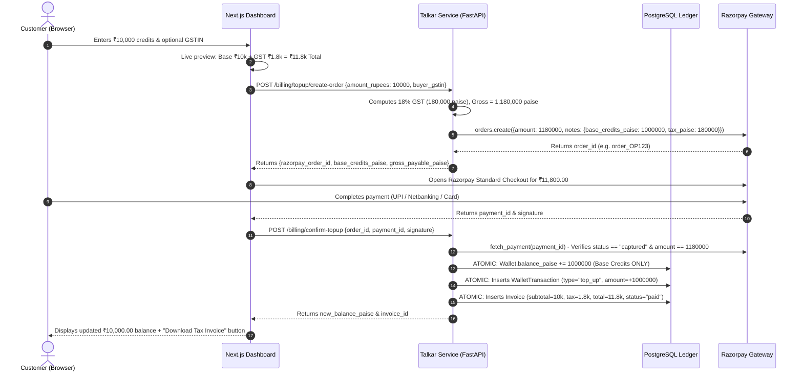

# Production Specification: B2B Tax-Exclusive GST Billing & Invoicing Engine

**Target Projects:**  
- `/Users/arnav/Internship/talkar-service` (FastAPI backend, PostgreSQL database, Razorpay SDK, background tasks, cron)
- `/Users/arnav/Internship/voice-agent` (Next.js dashboard, wallet page, invoice viewer/printer)

**Status:** Approved for Production Implementation  
**Standard:** B2B Tax-Exclusive Model (Base Credits + 18% GST at Checkout)  
**Authoritative Legal & Regulatory References:**
- Central Goods and Services Tax (CGST) Act 2017 (Section 31: Tax Invoice)
- CGST Rules 2017 (Rule 46: Contents of Invoice, Rule 48: Manner of Issuing Invoice)
- Integrated Goods and Services Tax (IGST) Act 2017 (Section 7, 8, 12: Inter-State & Intra-State Supplies, Place of Supply)
- Income Tax Act 1961 (Section 194J: Tax Deducted at Source on Technical Services)

---

## 1. Executive Summary & Root Cause Analysis

### 1.1 The Current Defect
In the current production codebase, when a user enters ₹10,000 for a wallet top-up:
1. Razorpay creates an order for ₹10,000 flat (no GST is added at checkout).
2. The customer's wallet balance is credited with the full ₹10,000 (1,000,000 paise).
3. However, on the frontend invoice viewer (`voice-agent/ui/src/app/invoice/[id]/page.tsx`), a hardcoded visual mockup formula is executed:
   ```typescript
   // Mock 18% GST for visual
   const amountRupees = (invoice.amount_paise / 100).toFixed(2); // 10000.00
   const taxAmount = (invoice.amount_paise / 100 * 0.18).toFixed(2); // 1800.00
   const subtotal = (invoice.amount_paise / 100 - parseFloat(taxAmount)).toFixed(2); // 8200.00
   ```
4. **Why this is fatal:**
   - **Mathematical Error:** ₹1,800 tax on an ₹8,200 subtotal is an effective tax rate of **21.95%**, not 18%. (18% of ₹8,200 is ₹1,476.00).
   - **Legal Non-Compliance:** Charging GST without displaying the seller's GSTIN, missing the CGST/SGST/IGST breakdown, missing the SAC code, and using non-sequential random UUID invoice numbers violates Section 31 and Rule 46 of the CGST Act.
   - **Revenue Loss:** If Talkar files this invoice with the GST department and remits tax out of the ₹10,000 received, Talkar loses ~15.25% of gross revenue to taxes while giving away 100% of the credits.

### 1.2 The Production Solution: B2B Tax-Exclusive Model
Migrate to the **B2B Tax-Exclusive Standard** used by enterprise cloud telecommunications and SaaS infrastructure providers (Twilio, AWS, Exotel, Plivo, Google Cloud):
- **User selects wallet credits:** ₹10,000.00 (Base Credits).
- **GST (18%) added at checkout:** ₹1,800.00.
- **Razorpay collects gross total:** **₹11,800.00**.
- **Wallet credited with:** **Exactly ₹10,000.00** in call credits.
- **Official GST Tax Invoice issued:** Base ₹10,000.00 + GST ₹1,800.00 = Total ₹11,800.00.
- **Input Tax Credit (ITC):** B2B customers input their GSTIN and claim the entire ₹1,800 back via Input Tax Credit (ITC) on the GST portal. Talkar retains the full ₹10,000 revenue.

---

## 2. Does Razorpay Support Native GST?

### Gateway Truth & Technical Capabilities
1. **Standard Orders API (`orders.create`):**
   - Razorpay’s Standard Orders API does **NOT** calculate GST automatically. It accepts a single gross integer `amount` in smallest currency units (paise).
   - The merchant server (`talkar-service`) is authoritatively responsible for calculating tax, determining CGST/SGST vs. IGST, and passing the gross amount to Razorpay.
   - Razorpay supports attaching arbitrary key-value metadata via `notes` (up to 15 keys, 256 characters each).
2. **GSTIN Capture:**
   - While Razorpay has an optional checkout toggle to display a GSTIN input, B2B platforms must capture and validate the customer’s GSTIN in their own UI prior to checkout so it is validated via regex, saved to `Customer.onboarding_form`, and stamped directly on ledger records.
3. **Razorpay Invoices API vs. Custom Engine:**
   - Razorpay Invoices (`POST /v1/invoices`) generates hosted payment links with line-item taxes, but cannot link directly to an internal wallet ledger, multi-tenant sub-org hierarchy, or in-app print engines.
   - **Architectural Decision:** Talkar maintains its own authoritative tax engine and ledger, using Razorpay strictly as the payment execution pipe.

---

## 3. Tax Engineering & Mathematical Specification

### 3.1 Mathematical Formulas & Precision Rules
All calculations across database, backend services, and API payloads must be executed strictly in integer paise (`BIGINT`, 1 Rupee = 100 Paise). Floating-point math is strictly forbidden in billing services.

For any requested base credit amount $B$ in paise:
$$\text{Tax Rate} = 18\% = 0.18$$
$$\text{Tax Amount (Paise)} = \text{round}(B \times 0.18)$$
$$\text{Gross Amount (Paise)} = B + \text{round}(B \times 0.18)$$

*Example: Base Credits = ₹10,000.00 (1,000,000 paise)*
- $B = 1,000,000\text{ paise}$
- $\text{Tax} = \text{round}(1,000,000 \times 0.18) = 180,000\text{ paise}$ (₹1,800.00)
- $\text{Gross Payable} = 1,180,000\text{ paise}$ (₹11,800.00)
- **Credited to Wallet:** Exactly $1,000,000\text{ paise}$ (₹10,000.00)

**Paisa Reconciliation Invariant:**  
$$\text{gross\_payable\_paise} = \text{base\_credits\_paise} + \text{tax\_paise}$$
The sum of the parts always equals the gross total down to the exact paisa, preventing 1-paisa rounding reconciliation errors.

### 3.2 Tax Jurisdiction & State Splitting Rules
* **Supplier Legal Entity:** `4THORBIT BUSINESS SOLUTIONS PVT LTD`
* **Supplier CIN:** `U74999JH2022PTC018848`
* **Supplier Location:** Lalpur, Ranchi, Jharkhand 834001, India
* **Supplier State Code:** `20` (Jharkhand)
* **Supplier GSTIN:** Configured via `TALKAR_COMPANY_GSTIN` environment variable
* **Service Accounting Code (SAC):** `998313` (Information technology streaming and cloud infrastructure services)

```
                            DETERMINE GST JURISDICTION
                                       │
                      ┌────────────────┴────────────────┐
                      ▼                                 ▼
           Buyer State Code == "20"          Buyer State Code != "20"
                 (Jharkhand)                     (Rest of India)
                      │                                 │
                      ▼                                 ▼
             INTRA-STATE SUPPLY                 INTER-STATE SUPPLY
             CGST (9%) + SGST (9%)                  IGST (18%)
             900 bps + 900 bps                       1800 bps
```

#### Determining Place of Supply (POS):
1. **Registered B2B Customer:** If buyer provides a valid 15-character GSTIN, POS State Code is `buyer_gstin[0:2]`.
   - If `buyer_gstin.startswith("20")`: **CGST 9% + SGST 9%**.
   - If `buyer_gstin.startswith("27")` (Maharashtra), `"07"` (Delhi), `"29"` (Karnataka), etc.: **IGST 18%**.
2. **Unregistered Customer:** State is resolved from `Customer.onboarding_form["billing_address"]` or `"state"`. If Jharkhand $\to$ CGST+SGST, otherwise $\to$ IGST.
3. **Special Economic Zone (SEZ) Units:** If customer is an SEZ unit with an approved Letter of Undertaking (`is_sez = true`), supply is treated as **Zero-Rated under LUT** (0% GST).
4. **International / Export of Services:** If customer address is outside India and payment is received in convertible foreign currency, supply is treated as **Zero-Rated Export of Services under LUT** (0% GST).

---

## 4. End-to-End Architectural Workflows



### 4.1 The 4 Core Financial Payment Flows

#### Flow 1: Manual Wallet Top-Up
1. Customer enters desired base credits: $B = ₹10,000$ (1,000,000 paise).
2. UI computes tax: $T = ₹1,800$, Gross = $₹11,800$.
3. Razorpay creates order for **₹11,800**.
4. Upon confirmation:
   - Wallet credited: **₹10,000.00**
   - Tax Invoice generated: Subtotal ₹10,000.00, GST ₹1,800.00, Total ₹11,800.00.

#### Flow 2: Tier Upgrade Shortfall
1. Customer on Starter wishes to switch to Pro (Activation minimum: ₹60,000 credits).
2. Existing wallet balance = ₹25,000 credits.
3. Shortfall in base credits = $₹60,000 - ₹25,000 = ₹35,000$ (3,500,000 paise).
4. `POST /billing/upgrade/create-order` computes:
   - Base Credits Needed: ₹35,000.00
   - GST (18%): ₹6,300.00
   - Gross Payable: **₹41,300.00**
5. Razorpay charges ₹41,300.00.
6. Upon payment confirmation:
   - Wallet is credited with ₹35,000.00 (balance becomes exactly ₹60,000).
   - Subscription tier upgrades to Pro.
   - Tax Invoice generated for ₹41,300.00 (Subtotal ₹35,000 + GST ₹6,300).

#### Flow 3: Automated Low-Balance Auto-Recharge
1. Master organization configures:
   - Threshold: ₹1,500 credits (`auto_recharge_threshold_paise = 150000`)
   - Recharge Amount: ₹5,000 credits (`auto_recharge_amount_paise = 500000`)
2. Call finishes, reducing wallet balance to ₹1,200 credits ($< ₹1,500$).
3. Background task `check_and_trigger_auto_recharge` triggers:
   - Acquires distributed Redis lock `auto_recharge_lock:{master_id}`.
   - Computes gross charge: $500,000 \times 1.18 = 590,000\text{ paise}$ (₹5,900.00).
   - Pre-creates Razorpay order with notes `{base_credits_paise: "500000", tax_paise: "90000", type: "auto_recharge"}`.
   - Calls `razorpay_client.charge_saved_card(amount_paise=590000)`.
   - On capture: credits wallet with **₹5,000.00**, generates automated Tax Invoice for **₹5,900.00**, releases lock, and emails invoice to the customer.

#### Flow 4: Direct Tier Switch (Existing Balance $\ge$ Min Deposit)
1. Customer already has ₹70,000 in wallet and switches to Pro (requires ₹60,000).
2. No payment is required.
3. Tier switches immediately. No tax invoice is issued (tax was already paid during top-up).

---

## 5. Database Schema & Data Models (`talkar-service`)

### 5.1 Updated `Invoice` Model (`db/models.py`)
```python
class Invoice(Base):
    __tablename__ = "invoices"

    id = Column(Integer, primary_key=True, index=True)
    customer_id = Column(Integer, ForeignKey("customers.id"), nullable=False, index=True)
    sub_org_id = Column(Integer, ForeignKey("customers.id"), nullable=True, index=True)
    dograh_org_id = Column(Integer, nullable=True, index=True)
    wallet_transaction_id = Column(Integer, ForeignKey("wallet_transactions.id"), unique=True)
    
    # Official Fiscal Sequence Number (Rule 46b: sequential per financial year)
    invoice_number = Column(Text, nullable=False, unique=True, index=True)
    
    # Financial breakdown in integer paise (1 Rupee = 100 Paise)
    subtotal_paise = Column(BigInteger, nullable=False)        # Net credits (e.g. 1000000)
    tax_paise = Column(BigInteger, nullable=False)             # Total GST (e.g. 180000)
    cgst_paise = Column(BigInteger, nullable=False, default=0)  # 90000 if intra-state
    sgst_paise = Column(BigInteger, nullable=False, default=0)  # 90000 if intra-state
    igst_paise = Column(BigInteger, nullable=False, default=0)  # 180000 if inter-state
    total_paise = Column(BigInteger, nullable=False)           # Gross total (e.g. 1180000)
    
    # Legacy alias for backward compatibility
    amount_paise = Column(BigInteger, nullable=False)          # Equal to total_paise
    
    # Compliance & GST Metadata
    tax_rate_bps = Column(Integer, nullable=False, default=1800)  # 1800 bps = 18.00%
    sac_code = Column(String(16), nullable=False, default="998313")
    invoice_type = Column(String(32), nullable=False, default="tax_invoice") # tax_invoice | internal_debit_note | credit_note
    place_of_supply = Column(String(64), nullable=True)        # e.g. "27-Maharashtra"
    buyer_gstin = Column(String(15), nullable=True)
    supplier_gstin = Column(String(15), nullable=False)
    
    # E-Invoicing & Compliance Readiness
    irn = Column(String(64), nullable=True)                    # 64-character hash from IRP
    signed_qr_code = Column(Text, nullable=True)               # Cryptographically signed QR payload
    
    status = Column(Text, nullable=False, default="paid")      # paid | refunded | cancelled | settled
    pdf_url = Column(Text, nullable=True)
    created_at = Column(DateTime(timezone=True), server_default=func.now())
```

### 5.2 PostgreSQL Migration Script
```sql
-- 1. Create fiscal invoice sequence counter table (bulletproof across FY rollovers)
CREATE TABLE IF NOT EXISTS fiscal_invoice_counters (
    financial_year VARCHAR(8) PRIMARY KEY,
    last_seq INTEGER NOT NULL DEFAULT 0,
    updated_at TIMESTAMP WITH TIME ZONE DEFAULT CURRENT_TIMESTAMP
);

-- 2. Add new tax columns to invoices table
ALTER TABLE invoices ADD COLUMN IF NOT EXISTS subtotal_paise BIGINT;
ALTER TABLE invoices ADD COLUMN IF NOT EXISTS tax_paise BIGINT;
ALTER TABLE invoices ADD COLUMN IF NOT EXISTS cgst_paise BIGINT DEFAULT 0;
ALTER TABLE invoices ADD COLUMN IF NOT EXISTS sgst_paise BIGINT DEFAULT 0;
ALTER TABLE invoices ADD COLUMN IF NOT EXISTS igst_paise BIGINT DEFAULT 0;
ALTER TABLE invoices ADD COLUMN IF NOT EXISTS total_paise BIGINT;
ALTER TABLE invoices ADD COLUMN IF NOT EXISTS tax_rate_bps INTEGER DEFAULT 1800;
ALTER TABLE invoices ADD COLUMN IF NOT EXISTS sac_code VARCHAR(16) DEFAULT '998313';
ALTER TABLE invoices ADD COLUMN IF NOT EXISTS invoice_type VARCHAR(32) DEFAULT 'tax_invoice';
ALTER TABLE invoices ADD COLUMN IF NOT EXISTS place_of_supply VARCHAR(64);
ALTER TABLE invoices ADD COLUMN IF NOT EXISTS buyer_gstin VARCHAR(15);
ALTER TABLE invoices ADD COLUMN IF NOT EXISTS supplier_gstin VARCHAR(15) DEFAULT '';
ALTER TABLE invoices ADD COLUMN IF NOT EXISTS irn VARCHAR(64);
ALTER TABLE invoices ADD COLUMN IF NOT EXISTS signed_qr_code TEXT;

-- 3. Backfill existing legacy invoices safely
UPDATE invoices 
SET 
  total_paise = amount_paise,
  subtotal_paise = ROUND(amount_paise / 1.18),
  tax_paise = amount_paise - ROUND(amount_paise / 1.18),
  igst_paise = amount_paise - ROUND(amount_paise / 1.18),
  invoice_type = 'tax_invoice'
WHERE subtotal_paise IS NULL;
```

---

## 6. Detailed Backend Implementation (`talkar-service`)

### 6.1 Configuration Module (`config.py`)
Add explicit organization tax identity variables:
```python
TALKAR_COMPANY_NAME: str = os.getenv("TALKAR_COMPANY_NAME", "4THORBIT BUSINESS SOLUTIONS PVT LTD")
TALKAR_COMPANY_CIN: str = os.getenv("TALKAR_COMPANY_CIN", "U74999JH2022PTC018848")
TALKAR_COMPANY_GSTIN: str = os.getenv("TALKAR_COMPANY_GSTIN", "20AAACB1234A1Z5")
TALKAR_COMPANY_PAN: str = os.getenv("TALKAR_COMPANY_PAN", "AAACB1234A")
TALKAR_COMPANY_ADDRESS: str = os.getenv(
    "TALKAR_COMPANY_ADDRESS", 
    "C/O Bundeshwari Devi, PN Bose Compound, Lalpur, Ranchi, Jharkhand 834001"
)
TALKAR_COMPANY_STATE_CODE: str = os.getenv("TALKAR_COMPANY_STATE_CODE", "20")
TALKAR_COMPANY_EMAIL: str = os.getenv("TALKAR_COMPANY_EMAIL", "it@4thorbit.in")
```

### 6.2 Sequential Number Generator Utility (`services/invoice_service.py`)
```python
import datetime
from sqlalchemy.ext.asyncio import AsyncSession
from sqlalchemy import text

async def generate_fiscal_invoice_number(db: AsyncSession, invoice_type: str = "tax_invoice") -> str:
    """
    Generates a strictly sequential Rule 46(b) compliant fiscal invoice number.
    Format: TLKR/{FY}/{SEQ:05d} (e.g. TLKR/26-27/00001)
    """
    now = datetime.datetime.now(datetime.timezone.utc)
    year = now.year
    if now.month < 4:
        fy_str = f"{str(year-1)[-2:]}-{str(year)[-2:]}"
    else:
        fy_str = f"{str(year)[-2:]}-{str(year+1)[-2:]}"
        
    prefix = "TLKR" if invoice_type == "tax_invoice" else "CN-TLKR"
    
    # Atomic counter upsert in PostgreSQL
    query = text("""
        INSERT INTO fiscal_invoice_counters (financial_year, last_seq, updated_at)
        VALUES (:fy, 1, NOW())
        ON CONFLICT (financial_year)
        DO UPDATE SET last_seq = fiscal_invoice_counters.last_seq + 1, updated_at = NOW()
        RETURNING last_seq;
    """)
    result = await db.execute(query, {"fy": fy_str})
    seq_val = result.scalar()
    return f"{prefix}/{fy_str}/{seq_val:05d}"
```

### 6.3 Order Creation Endpoint (`routers/billing.py`)
```python
class TopupRequest(BaseModel):
    dograh_org_id: int
    amount_rupees: float  # Base credits desired by user (e.g. 10000.0)
    buyer_gstin: Optional[str] = None

@router.post("/topup/create-order")
async def create_topup_order(
    data: TopupRequest,
    db: AsyncSession = Depends(get_db),
    x_talkar_email: Optional[str] = Header(None, alias="X-Talkar-Email"),
    authorization: Optional[str] = Header(None, alias="Authorization"),
):
    # Auth & customer validation ...
    base_credits_paise = int(round(data.amount_rupees * 100))
    if base_credits_paise < min_allowed_paise:
        raise HTTPException(400, f"Minimum top-up is ₹{min_allowed_paise // 100}")

    # Validate buyer GSTIN format if provided
    gstin_clean = data.buyer_gstin.strip().upper() if data.buyer_gstin else None
    if gstin_clean:
        if not validate_gstin_format(gstin_clean):
            raise HTTPException(400, "Invalid GSTIN format. Expected 15-character Indian GSTIN.")
        form = customer.onboarding_form or {}
        form["gstin"] = gstin_clean
        customer.onboarding_form = dict(form)
        flag_modified(customer, "onboarding_form")
        await db.commit()

    # Calculate 18% GST and gross amount
    tax_paise = int(round(base_credits_paise * 0.18))
    gross_payable_paise = base_credits_paise + tax_paise

    # Resolve tax jurisdiction
    buyer_state = gstin_clean[:2] if gstin_clean else (customer.onboarding_form or {}).get("state_code", "27")
    is_intra_state = (buyer_state == TALKAR_COMPANY_STATE_CODE)

    order = await razorpay_client.create_topup_order(
        amount_paise=gross_payable_paise,
        receipt=f"topup_{customer.id}_{int(time.time())}",
        customer_id=customer.id,
        extra_notes={
            "customer_id": str(customer.id),
            "dograh_org_id": str(data.dograh_org_id),
            "base_credits_paise": str(base_credits_paise),
            "tax_paise": str(tax_paise),
            "buyer_gstin": gstin_clean or "",
            "is_intra_state": "true" if is_intra_state else "false",
            "type": "wallet_topup",
        }
    )

    return {
        "razorpay_order_id": order["id"],
        "base_credits_paise": base_credits_paise,
        "tax_paise": tax_paise,
        "gross_payable_paise": gross_payable_paise,
        "currency": "INR",
        "breakdown": {
            "credits_rupees": base_credits_paise / 100.0,
            "gst_rupees": tax_paise / 100.0,
            "total_payable_rupees": gross_payable_paise / 100.0,
            "tax_type": "CGST+SGST" if is_intra_state else "IGST"
        }
    }
```

### 6.4 Confirmation & Webhook Processing (`services/billing_service.py`)
```python
# In credit_wallet():
# Extract base credits from notes or apply fail-safe mathematical inverse
notes = payment.get("notes", {})
if notes.get("base_credits_paise"):
    base_credits_paise = int(notes["base_credits_paise"])
    tax_paise = int(notes.get("tax_paise", verified_gross_paise - base_credits_paise))
else:
    base_credits_paise = int(round(verified_gross_paise / 1.18))
    tax_paise = verified_gross_paise - base_credits_paise

# Credit wallet with BASE CREDITS ONLY
result = await db.execute(
    update(Wallet)
    .where(Wallet.customer_id == master_id)
    .values(balance_paise=Wallet.balance_paise + base_credits_paise)
    .returning(Wallet)
)

# Insert fiscal compliant Invoice
buyer_state = (buyer_gstin or "")[:2] if buyer_gstin else (customer.onboarding_form or {}).get("state_code", "27")
is_intra = (buyer_state == TALKAR_COMPANY_STATE_CODE)
cgst = tax_paise // 2 if is_intra else 0
sgst = tax_paise - cgst if is_intra else 0
igst = tax_paise if not is_intra else 0

invoice = Invoice(
    customer_id=invoice_customer_id,
    sub_org_id=effective_sub_org_id,
    dograh_org_id=effective_dograh_org_id,
    wallet_transaction_id=transaction.id,
    invoice_number=await generate_fiscal_invoice_number(db, "tax_invoice"),
    subtotal_paise=base_credits_paise,
    tax_paise=tax_paise,
    cgst_paise=cgst,
    sgst_paise=sgst,
    igst_paise=igst,
    total_paise=verified_gross_paise,
    amount_paise=verified_gross_paise,
    tax_rate_bps=1800,
    sac_code="998313",
    invoice_type="tax_invoice",
    place_of_supply=f"{buyer_state}-State",
    buyer_gstin=buyer_gstin,
    supplier_gstin=TALKAR_COMPANY_GSTIN,
    status="paid"
)
db.add(invoice)
```

### 6.5 Updated Invoices API Endpoints (`routers/invoices.py`)
```python
@router.get("/{invoice_id}")
async def get_invoice(invoice_id: int, ...):
    # Auth & customer validation ...
    return {
        "id": invoice.id,
        "invoice_number": invoice.invoice_number,
        "created_at": invoice.created_at,
        "status": invoice.status,
        "invoice_type": getattr(invoice, "invoice_type", "tax_invoice"),
        "financials": {
            "subtotal_paise": invoice.subtotal_paise or int(round(invoice.amount_paise / 1.18)),
            "tax_paise": invoice.tax_paise or (invoice.amount_paise - int(round(invoice.amount_paise / 1.18))),
            "cgst_paise": getattr(invoice, "cgst_paise", 0),
            "sgst_paise": getattr(invoice, "sgst_paise", 0),
            "igst_paise": getattr(invoice, "igst_paise", 0),
            "total_paise": invoice.total_paise or invoice.amount_paise,
            "tax_rate_percentage": 18.0
        },
        "tax_metadata": {
            "sac_code": getattr(invoice, "sac_code", "998313"),
            "place_of_supply": getattr(invoice, "place_of_supply", "27-Maharashtra"),
            "reverse_charge": False,
        },
        "seller": {
            "company_name": TALKAR_COMPANY_NAME,
            "cin": TALKAR_COMPANY_CIN,
            "gstin": TALKAR_COMPANY_GSTIN,
            "pan": TALKAR_COMPANY_PAN,
            "address": TALKAR_COMPANY_ADDRESS,
            "state_code": TALKAR_COMPANY_STATE_CODE,
            "email": TALKAR_COMPANY_EMAIL
        },
        "buyer": {
            "customer_id": customer.id,
            "company_name": customer.company_name,
            "contact_name": customer.contact_name,
            "contact_email": customer.contact_email,
            "gstin": getattr(invoice, "buyer_gstin", None) or onboarding.get("gstin"),
            "billing_address": onboarding.get("billing_address") or onboarding.get("address"),
        }
    }
```

---

## 7. Frontend UI Specification (`voice-agent`)

### 7.1 Wallet Top-Up Component (`ui/src/app/wallet/page.tsx`)
```tsx
// State calculation
const parsedBaseRupees = parseInt(topupAmount) || 0;
const taxRupees = Math.round(parsedBaseRupees * 0.18);
const totalPayableRupees = parsedBaseRupees + taxRupees;

// Order Summary Card
<div className="bg-zinc-50 dark:bg-zinc-900/60 p-4 rounded-xl border border-border mb-6">
  <div className="flex justify-between text-sm text-muted-foreground mb-1">
    <span>Wallet Credits:</span>
    <span className="font-semibold text-foreground">₹{parsedBaseRupees.toLocaleString('en-IN')}</span>
  </div>
  <div className="flex justify-between text-sm text-muted-foreground mb-2">
    <span>GST (18% - ITC Claimable):</span>
    <span className="font-semibold text-foreground">₹{taxRupees.toLocaleString('en-IN')}</span>
  </div>
  <div className="h-px w-full bg-border my-2" />
  <div className="flex justify-between items-center text-base font-bold">
    <span>Total Payable:</span>
    <span className="text-primary font-black text-lg">₹{totalPayableRupees.toLocaleString('en-IN')}</span>
  </div>
</div>

<Button 
  onClick={() => handleTopup(false)}
  disabled={!parsedBaseRupees || parsedBaseRupees < minTopup || isProcessing}
  className="w-full h-11 text-sm font-bold shadow-md"
>
  {isProcessing ? "Processing..." : `Pay ₹${totalPayableRupees.toLocaleString('en-IN')} Securely`}
</Button>
```

### 7.2 GST Tax Invoice Page (`ui/src/app/invoice/[id]/page.tsx`)
Remove lines 67–69 (`// Mock 18% GST for visual`). Bind directly to backend `financials`, `seller`, and `buyer`:
```typescript
const subtotalRupees = ((invoice.financials?.subtotal_paise ?? Math.round(invoice.amount_paise / 1.18)) / 100).toFixed(2);
const taxRupees = ((invoice.financials?.tax_paise ?? (invoice.amount_paise - Math.round(invoice.amount_paise / 1.18))) / 100).toFixed(2);
const totalRupees = ((invoice.financials?.total_paise ?? invoice.amount_paise) / 100).toFixed(2);
const isIntraState = (invoice.financials?.cgst_paise ?? 0) > 0;
```

---

## 8. Complete Production Edge Case Matrix

| # | Edge Case Scenario | Potential Failure Mode | Production Engineered Solution |
| :--- | :--- | :--- | :--- |
| **1** | **Concurrent Webhook & Client Confirmation** | Both endpoints fire simultaneously upon payment capture, risking double crediting of wallet balance. | Handled via PostgreSQL advisory transaction lock `pg_advisory_xact_lock` + partial unique index `idx_wallet_transactions_razorpay`. Second request hits duplicate key guard and cleanly returns existing balance. |
| **2** | **Client-Side Amount Tampering** | Malicious actor calls `/confirm-topup` claiming they paid ₹11,800 when they only paid ₹590. | Backend strictly ignores client-supplied `amount_paise`. It calls Razorpay's authoritative `fetch_payment(id)` API, verifies status is `"captured"`, and uses the gateway's verified amount. |
| **3** | **Internal Phone Number Lease Invoicing** | Leases are deducted from the wallet balance. If another tax invoice with 18% GST is issued, it causes illegal double taxation. | Internal phone number leases and call-minute deductions are recorded as `invoice_type = "internal_debit_note"` with `tax_paise = 0`. The tax was already levied at the time of wallet top-up. |
| **4** | **Sub-Org Top-Up Under Master Agency** | Sub-org adds funds; invoice is incorrectly issued in Master's name or GSTIN. | Top-up transaction updates Master wallet balance, but the `Invoice` row stamps `customer_id = sub_org.id`, `sub_org_id = sub_org.id`, and uses the Sub-Org's company name and GSTIN. |
| **5** | **Auto-Recharge Recurring Mandate Limit** | Customer's card mandate was authorized with a ₹5,000 cap; auto-recharge of ₹5,900 gross is rejected by the issuing bank. | In `/wallet/add-card/session`, the mandate upper limit (`max_amount`) is set to ₹100,000 (standard RBI e-mandate limit), allowing recurring charges of Base + 18% GST without exceeding mandate limits. |
| **6** | **Auto-Recharge Failure Stampede** | Customer's card fails (expired/insufficient funds), causing call deduction tasks to spam Razorpay API repeatedly. | Guarded by Redis cooldown key (`auto_recharge_cooldown:{master_id}`, 1-hour TTL) + in-memory process lock. After failure, auto-recharge is disabled and customer receives alert email. |
| **7** | **Legacy Invoice Backward Compatibility** | Historic invoices stored in DB have `subtotal_paise = NULL` and only `amount_paise = 1000000`. | DB migration backfills historical records via $B = \text{round}(\text{amount} / 1.18)$. Frontend falls back to `invoice.subtotal_paise ?? Math.round(invoice.amount_paise / 1.18)` without crashing. |
| **8** | **Chargeback / Refund Processing** | Customer initiates a chargeback or refund of ₹11,800 via Razorpay. | System debits the wallet by the base credits credited ($B$). It issues a GST Credit Note record (`invoice_type = "credit_note"`) with serial `CN-TLKR/{FY}/{SEQ:05d}` referencing the original invoice to reverse the tax liability. |
| **9** | **Fractional Paisa Rounding Discrepancy** | Custom credit amounts produce fractional paise where $B + \text{Tax} \ne \text{Total}$. | Strict integer rupee input validation on UI. At the backend, `tax_paise = round(base_paise * 0.18)` and `gross_paise = base_paise + tax_paise`. Total always equals exact sum of parts. |
| **10** | **Invalid Buyer GSTIN Entry** | Customer inputs invalid or malformed GSTIN (e.g. typos, 14 chars). | Strict frontend regex check (`^[0-9]{2}[A-Z]{5}[0-9]{4}[A-Z]{1}[1-9A-Z]{1}Z[0-9A-Z]{1}$`). If invalid, form warns customer. Backend re-validates before creating order. |
| **11** | **TDS (Tax Deducted at Source) Under Section 194J** | B2B enterprise customer claims mandatory 2% TDS withholding. | Gateways cannot deduct TDS dynamically online. Customer pays gross ₹11,800. At quarter end, customer submits Form 16A TDS certificate to `finance@talkar.in`. Talkar validates certificate on TRACES and credits the 2% TDS amount (₹200 on ₹10k base) directly into the customer's wallet as promotional/TDS credits. |
| **12** | **Special Economic Zone (SEZ) Supplies** | Customer is located in an SEZ unit and claims 0% GST under LUT. | Customer provides SEZ Certificate & Form I. Admin marks `is_sez = true` on customer record. Checkout applies `tax_paise = 0`, charges flat base credits, and stamps invoice with statutory declaration: *"Supply to SEZ unit for authorized operations under LUT without payment of integrated tax."* |
| **13** | **Missing Notes Fallback on Webhook Capture** | Network glitch causes Razorpay webhook payload to omit custom order notes. | If `notes.base_credits_paise` is missing, backend executes mathematical inverse: $B = \text{round}(\text{Gross} / 1.18)$ and $\text{Tax} = \text{Gross} - B$, ensuring the wallet is never over-credited. |

---

## 9. Implementation Checklist & Verification Plan

- [ ] **Step 1: Database Migration (`talkar-service`)**
  - Execute SQL migration adding `subtotal_paise`, `tax_paise`, `cgst_paise`, `sgst_paise`, `igst_paise`, `total_paise`, `sac_code`, `buyer_gstin`, `irn`, `signed_qr_code`, and `fiscal_invoice_counters`.
  - Verify backfill query against existing invoices in database.
- [ ] **Step 2: Backend Configuration & Service (`talkar-service`)**
  - Add company GSTIN, CIN, address, and PAN to `config.py`.
  - Implement `generate_fiscal_invoice_number` in `services/invoice_service.py`.
- [ ] **Step 3: Update Order Creation & Confirmation Endpoints (`routers/billing.py`)**
  - Update `create_topup_order` to charge Base + 18% GST and store metadata in notes.
  - Update `confirm_topup` and `webhook/razorpay` to credit ONLY base credits to the wallet and record full tax breakdown on the `Invoice`.
  - Update `create_upgrade_order` to add 18% GST to tier upgrade shortfalls.
  - Update `check_and_trigger_auto_recharge` to charge Gross on card and credit Base on wallet.
- [ ] **Step 4: Update Invoices API (`routers/invoices.py`)**
  - Return `subtotal_paise`, `tax_paise`, `cgst_paise`, `sgst_paise`, `igst_paise`, `total_paise`, `sac_code`, `place_of_supply`, and seller details.
- [ ] **Step 5: Update Frontend Wallet UI (`voice-agent`)**
  - Update `ui/src/app/wallet/page.tsx` with live Base + GST + Total breakdown and GSTIN input field.
- [ ] **Step 6: Update Frontend Invoice Viewer (`voice-agent`)**
  - Remove mock calculation from `ui/src/app/invoice/[id]/page.tsx` and bind to authoritative fields.
- [ ] **Step 7: Automated Testing**
  - Run pytest test suite for billing and topup.
  - Verify wallet balance increases by base amount only.
